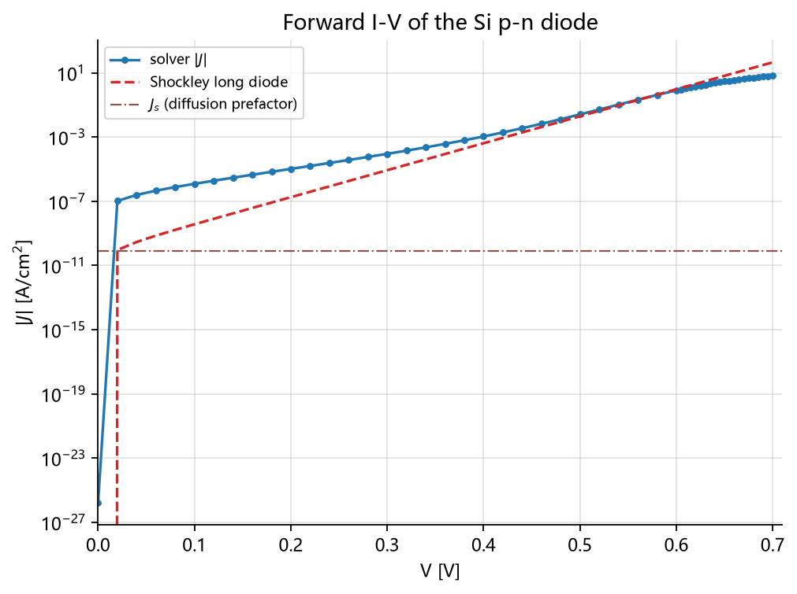
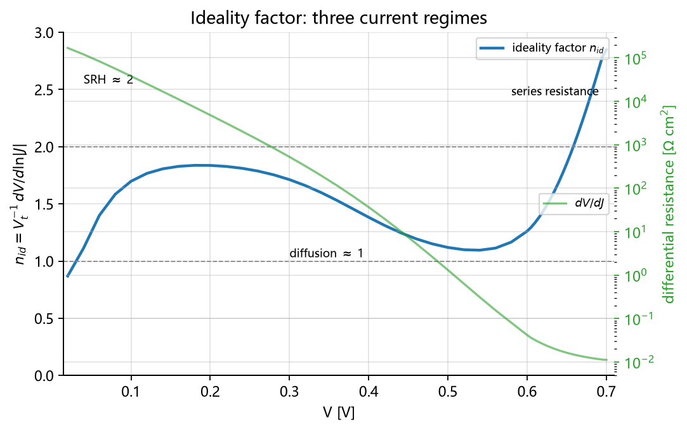
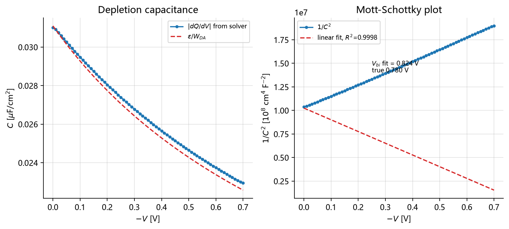
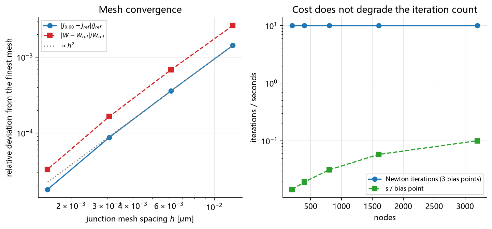
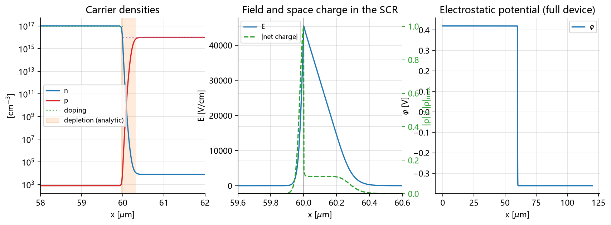
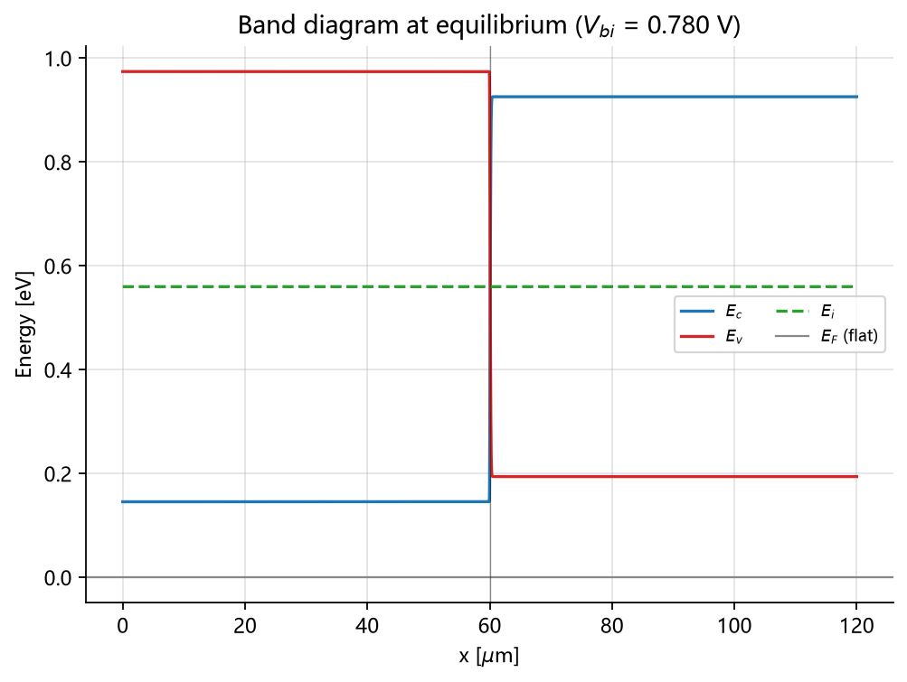
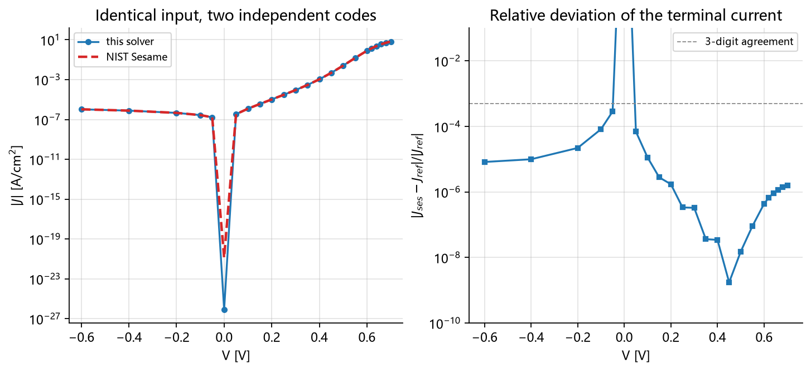
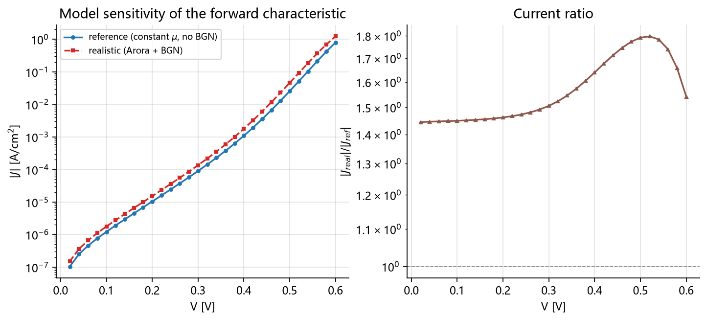
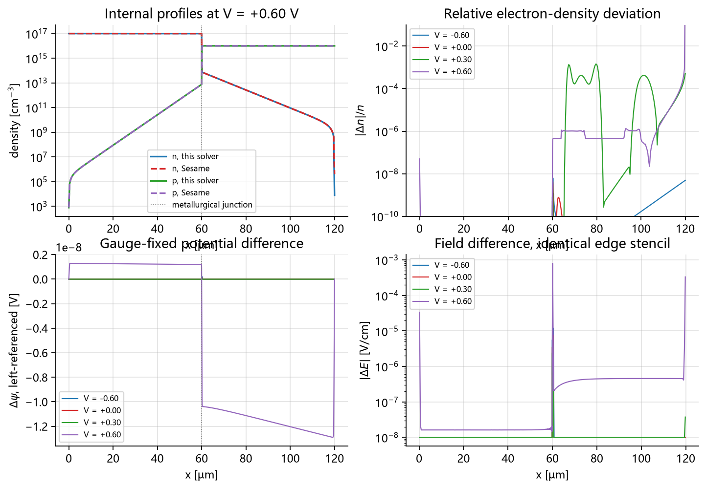

<div align="center">

# Drift–Diffusion PN Junction

**一维漂移-扩散求解器与 Si p-n 结全套验证**

[](https://github.com/ilo-love7/drift-diffusion-pn-junction/actions/workflows/ci.yml)


<p align="center">
  <a href="./README.md">English</a> · <b>简体中文</b>
</p>

</div>

---

从零实现的 1D 稳态漂移-扩散–泊松求解器：有限体积 + Scharfetter–Gummel _link_、解析稀疏
雅可比、阻尼 Newton + 自适应偏压延拓。验证走两条独立路线——**闭式半导体理论**（L1/L2）和
**第三方器件模拟器 NIST Sesame 2.0**（L3）。只用 numpy/scipy，无 GPU、无编译链，
整套验证本地一条命令约 90 秒复现。

**113 collected / 113 passed / 0 skipped**（≈23 s）· 九个验证案例（≈93 s）· Python 3.10 / 3.12 / 3.13 全部在 CI 上通过 · MIT（其中 vendored Sesame 部分仍为 3-clause BSD）

---

## 结果一览

| # | 校核内容 | 实测值 | 判定 |
|---|---|---|---|
| 1 | 热平衡不变量（V = 0，1601 节点） | 端电流 1.63e-26 A/cm²，准费米能级平坦度 1.77e-15 V，max\|np/n_i²−1\| = 6.37e-14，V_bi 与解析值相对误差 **0.0** | ✅ |
| 2 | 正偏 I-V，0 → 0.70 V（51 点） | 每点 **≤ 4 次 Newton 迭代**，加权残差 9.68e-9；理想因子低偏 1.58 → 中偏 1.12；由 ln J – V_j 斜率反演热电压，误差 **3.1 %** | ✅ |
| 3 | 反偏分支 + C-V，0 → −0.70 V（71 点） | 由 ε/C 反推的耗尽层宽与解析值最大偏差 **1.67 %**；Mott–Schottky R² = 0.99977（有效掺杂偏 6.5 %）；SRH 产生速率达限速值的 0.99999 | ✅ |
| 4 | 网格无关性，201 → 3201 节点 | 观测阶数 **1.95（J@0.60）/ 1.99（W）**；1601 与 3201 差 1.8e-5 / 3.3e-5。*适用边界：本器件 + 本网格模板。* J@0.30 的差值已落到 7.2e-8 的求解器噪声底，阶数被失真（4.52），**不作为判据**。 | ✅ 二阶 |
| 5 | 与 **NIST Sesame 2.0** 交叉对照（输入完全一致，23 个偏压点） | 端电流最大相对偏差 **2.85e-4**、中位 1.29e-6；J(0.60 V) = −0.8014472 vs −0.8014469 A/cm²；本机本求解器快 **8.6 倍**。*本案例只比端电流这一个标量，内部剖面见案例 7；两码共用同一套模型，所以这一层对"模型是否完备"没有任何发言权，reference truth 仍留在 L1。* | ✅ |
| 6 | 真实硅物性（Arora 迁移率 + Slotboom 带隙窄化） | V_bi 下降 **21.3 mV**，局部 n_i ×1.60，J_s ×1.90，J(0.60 V) ×1.54；平衡不变量仍是 7.99e-14 | ✅ |
| 7 | 与 **NIST Sesame 2.0** 的**内部剖面**对照（同一网格、同一输入，4 个偏压点：−0.60 / 0 / 0.30 / 0.60 V） | 电位最大差 **1.29e-8 V**；平衡/反偏密度最大相对偏差 **7.91e-9**；体区电场相对偏差 **1.50e-7**。两码电位零点相差一个常数 **−4.615497472 V**，与解析的"本征能级参考"预测**逐位相同**（误差 0.0）且随偏压不漂移（spread 0.0）。正偏密度偏差 1.48e-3，最大点落在**接触处**（x = 119.6 µm），网格加密到 1601 节点后不减反增（8.50e-4 → 1.76e-3）——是接触/格式前提之差，不是分辨率不足 | ✅ |
| 8 | **瞬态 slab：两个解析时间常数 + 积分器阶数**（求解器新增时间项后的必答题） | 介质松弛模率 σ/ε（τ=47.9 fs）与等离子体模率 1/τ+D_a k²（τ=9.92 ns）实测相对误差 **4.0e-7 / 2.0e-5**——两率差五个数量级，各自独立步长与容差（容差取自扫描而非取值偏好）；θ 格式收敛阶实测 **0.98（BE，理论 1）/ 2.01（CN，理论 2）**；单指数衰减（fit rms ≤ 2.8e-6），速率不随拟合窗口/扰动幅度/容差漂移；注入扫描定位线性区边界（Δn ≤ 1e12 cm⁻³ 时 rate/λ > 0.99999；忽略双极扩散项会犯 8.5e-3 的错，高于 5e-3 门禁——**该不可忽略**）；位移电流不变量：仅粒子电流最大不均匀度 1.0000264，加 ε dE/dt 后降至 5.29e-5（**×1.9e4**），两项之和按镜像对称严格消失（4.1e-13） | ✅（23 项门禁全过） |
| 9 | **结关断瞬态：0.60 V → −0.60 V 电压阶跃**（开关行为） | 位移电流让总电流在提取平台期空间均匀度到 **6.4e-10**（只算粒子电流是 0.445，改善 **7e8 倍**）；载流子记账闭合 **8.8e-10 / 1.0e-10**；长链落到冷稳态解（电位 6.9e-8 V、过剩薄层电荷 8.1e-5）；提取平台对前向片电导的**零参数**预测吻合 **1.2%**；提取电荷时间阶 **1.00**、空间阶 **2.08**；14 项门禁全过 | ✅（14 项门禁全过） |
| 10 | 单元测试 | **113 collected / 113 passed / 0 skipped**，含解析 vs 有限差分雅可比、带隙窄化下的广义 SG 回归测试、无窄化时的严格退化断言、8 项 Sesame 剖面对照断言与瞬态模态/时间离散映射测试 | ✅ |
| 11 | 复现成本 | 九案例 **≈93 s**（`--fast` ≈9 s）；产物全部是本地 CSV/PNG/JSON | ✅ |

尺度校核（Si p-n 结，N_D = 1e17、N_A = 1e16 cm⁻³，300 K）：
V_bi = 0.78013 V，W(0) = 0.3331 µm，E_max(0) = 4.68e4 V/cm，
L_n = 5.91 µm，L_p = 3.52 µm，J_s = 7.87e-11 A/cm²。

## 图

| 正偏 I-V | 理想因子 | 耗尽层 / C-V | 网格收敛 |
|---|---|---|---|
|  |  |  |  |

| 平衡态分布 | 能带图 | Sesame 交叉对照 | 真实硅 vs 理想硅 |
|---|---|---|---|
|  |  |  |  |

| Sesame 内部剖面对照：0.60 V 处的电位 / 密度 / 电场 |
|---|
|  |

> 图内文字目前是英文（matplotlib 用默认字体，避免容器里缺中文字体变方框）。需要中文版图可以自行换字体重渲染，见「快速开始」。

---

## 快速开始

```bash
pip install -r requirements.txt

python scripts/run_all.py              # 九个案例全跑，≈93 s -> data/ figures/ + 汇总表
python scripts/run_all.py --fast       # 跳过网格研究、Sesame 对照与瞬态 slab，≈9 s
python scripts/run_all.py --only 2 5   # 只跑指定案例
python -m pytest -q                    # 113 项测试，≈23 s
```

每个案例也能单独运行并打印自己的指标，例如 `python scripts/case1_equilibrium.py`。
`pip install -e .`（`src/p5dd`）同样可用，但脚本与测试套件会自己把 `src/` 插入 `sys.path`，
所以 clone 下来不装包也能直接跑全部东西。

产物：`data/metrics_caseN.json`（结构化指标——本页引用的每个数字都从这些文件回读）、
`data/caseN_*.csv`（逐偏压 / 逐节点数据）、`figures/caseN_*.png`（15 张图）、
`data/summary.json`（含各案例墙钟的汇总）。

## 用途 / 你能用它做什么

六个可直接上手的使用场景，每个都有可运行的入口（纯 CPU、只需 numpy/scipy，无编译链、无外部数据）：

| 用途 | 真实入口（脚本/模块路径） |
|---|---|
| **把求解器当库调用**（解单个偏压点、扫 I-V、取有量纲的物理场） | `p5dd.DDSolver.solve_point` / `.iv_sweep` / `.physical_state` / `.currents` · [src/p5dd/solver.py](src/p5dd/solver.py) |
| **复现三层证据链**（L1 解析不变量 → L2 网格无关性 → L3 第三方交叉对照） | `python scripts/run_all.py` · L1：[scripts/case1_equilibrium.py](scripts/case1_equilibrium.py)、[scripts/case2_forward_iv.py](scripts/case2_forward_iv.py)、[scripts/case3_reverse_cv.py](scripts/case3_reverse_cv.py) · L2：[scripts/case4_mesh_convergence.py](scripts/case4_mesh_convergence.py) · L3：[scripts/case5_sesame_crosscheck.py](scripts/case5_sesame_crosscheck.py)、[scripts/case7_sesame_profiles.py](scripts/case7_sesame_profiles.py) |
| **单独调用解析参考与后处理**（V_bi、耗尽层、Shockley、C = dQ/dV、Mott–Schottky） | `p5dd.built_in_potential`、`p5dd.depletion`、`p5dd.shockley`、`p5dd.mott_schottky` · [src/p5dd/theory.py](src/p5dd/theory.py)、[src/p5dd/analysis.py](src/p5dd/analysis.py) |
| **网格收敛研究与基准算例**（201 → 3201 节点，实测观测阶） | [scripts/case4_mesh_convergence.py](scripts/case4_mesh_convergence.py) · [tests/test_mesh_convergence.py](tests/test_mesh_convergence.py) · [data/metrics_case4.json](data/metrics_case4.json) |
| **复现瞬态 / 开关行为**（介质模与等离子体模、0.60 → −0.60 V 关断） | [scripts/case8_slab_time_constants.py](scripts/case8_slab_time_constants.py) · [scripts/case9_turnoff.py](scripts/case9_turnoff.py) · [src/p5dd/transients.py](src/p5dd/transients.py) |
| **拿本仓库当参照去验证别人的求解器**（同一套节点数组、同一组输入、逐点偏差已入库） | [reference/PROVENANCE.md](reference/PROVENANCE.md) · [data/case5_sesame_crosscheck.csv](data/case5_sesame_crosscheck.csv) · [data/case7_sesame_profiles.csv](data/case7_sesame_profiles.csv) |

典型用途：① 作为**新漂移-扩散离散格式的对照实现**；② 半导体器件论文的**可复现实验台**
（一条命令、≈93 s）；③ 数值器件课程的**教学材料**——L1 不变量与 L2 观测阶是读者第一天就能自己量出来的
两件事；④ 在相信某个第三方 TCAD 在本器件上的数字之前做一次**预检**。

全部可离线复现：`python -m pytest -q`（113 项测试，≈23 s）不需要任何数据集、也不需要编译链——
`requirements.txt` 只有 numpy + scipy + matplotlib + pytest。Sesame 对照是可选的（副本已 vendored 在
`reference/`），删掉后套件报告 89 passed / 12 skipped，而跳过一律不计入通过。
CI 在 Linux 上跑测试套件与九个案例，覆盖 Python 3.10 / 3.12 / 3.13
（[.github/workflows/ci.yml](.github/workflows/ci.yml)）。

## 当作库使用

```python
import sys; sys.path.insert(0, "src")
import numpy as np
from p5dd import DDSolver, reference_device, realistic_device

dev = reference_device(n_nodes=1601)   # 恒定迁移率、无带隙窄化 -> 可与解析式/Sesame 直接比较
sol = DDSolver(dev, tol=1e-8)

u, rep = sol.solve_point(0.0)          # rep：迭代次数 / 残差 / 是否收敛 / 回退次数
st = sol.physical_state(u)             # x, psi, n, p, E, Jn, Jp, J, Ec, Ev, Ei, Ef（有量纲）
Jn, Jp = sol.currents(u)               # 各节点连接电流 [A/cm^2]
print(sol.total_current(u))            # 端电流 [A/cm^2]

U, J, reps = sol.iv_sweep(np.arange(0.0, 0.71, 0.02))   # 自适应偏压延拓
```

符号约定：n 区在 x = 0，因此**正偏对应负的端电流**（器件内部常规电流从 p 接触流向 n 接触）。
`theory.shockley()` 用同一套约定，可逐点直接比较。

解析参考与后处理可以单独 import：`built_in_potential`、`depletion`、`minority_transport`、
`saturation_current`、`shockley`、`ideality_factor`、`peak_field`、`depletion_charge`、
`capacitance`、`mott_schottky`、`expected_capacitance`、`net_recombination_rate`。

---

## 怎么做的，以及为什么在平衡态是"精确"而不是"够小"

**未知量。** 双势（Slotboom）变量 `psi, phi_n, phi_p`，以 V_t 为单位，
`n = r_ni·exp(psi − phi_n)`、`p = r_ni·exp(phi_p − psi)`。载流子密度以指数形式承载，
因此**严格为正**——大偏压下不会出现负密度或下溢失效。欧姆接触把 `phi_n`、`phi_p`、`psi`
钉在一起，等价于同时钉住两种载流子密度，但每个边界行的量级是 O(1) 而不是 1e-15。

**通量：Scharfetter–Gummel link。** 一条 SG link 是在"link 内势降落线性"的假设下对
漂移-扩散常微分方程做的精确积分，其系数就是 Bernoulli 函数。关键性质：当准费米能级为常数时，
离散通量**恒等于零**，于是"平衡态零电流"和"np = n_i²"是格式的解析性质，不是调出来的。
这就是案例 1 能到 1e-14 的原因。

**带隙窄化必须用广义 SG。** 若 `n_i` 随位置变化，平衡态密度比变成
`n_R/n_L = (n_iR/n_iL)·exp(Δpsi)`，单独的 `Δpsi` 不再重构 Boltzmann 因子：朴素格式会在掺杂
突变处留下虚假通量，并破坏 `np = n_i(x)²`。本实现的 Bernoulli 自变量取
**电子 Δpsi + Δln n_i、空穴 Δpsi − Δln n_i**（[src/p5dd/solver.py](src/p5dd/solver.py)），
由 `B(−x)/B(x) = e^x` 即可证明对**任意** `n_i(x)` 两条 link 电流都为零。
回归测试见 [tests/test_equilibrium.py](tests/test_equilibrium.py)：真实器件的平衡态违背量从
0.125 降到 7.99e-14，Newton 从 5 次降到 4 次；在没有带隙窄化时，这个推广可证明是惰性的
（逐节点 `_dln_ni == 0`），所以参考器件逐比特不变。

**网格。** 节点按 `1/h` 度量下的等弧长布置：结附近 4 nm，中性区 50 nm，邻居比 < 1.15
（没有突变式渐变），且节点数翻倍时 h_min 与 h_max 同时减半——正是这一点让案例 4 的观测阶
成为干净的二阶。

**线性代数。** 解析稀疏雅可比（逐 link 的 Bernoulli 导数 + SRH 链式法则），
`scipy.sparse.linalg.spsolve`；阻尼 Newton 带无穷范数步长上限 `du_cap = 4 V_t`，
使第一步不会把 Slotboom 指数推出可用范围，再在同一方向残差上做回退。

**停止判据。** 逐项缩放的加权无穷范数 `max|F_i|/s_i`，其中 `s_i` 是该方程自身各项幅值之和
（下限 1），权重在一个 Newton 步内冻结。这让判据与网格无关——绝对残差被 1/h² 放大，
无法表达"平衡态满足到什么程度"。可达下限由稀疏 LU 决定（1601 节点时 ≈3e-9），
对应端电流误差 < 1e-6 A/cm²。

**偏压扫描。** 自适应延拓在失败时把步长减半（细到 1e-13 V），于是 0 到 0.70 V 每点都在
≤ 4 次 Newton 内收敛，无需手工调参；把 `du_cap` 收到 0.5 仍收敛到同一状态。

---

## 验证设计：三层证据，以及每层不能证明什么

这里可复用的产出是**框架**，不是某个器件结果，所以每条断言都写清自己属于哪一层。
规则见 [reports/technical-report.md](reports/technical-report.md) §1.2–§1.5，
逐条判定见 [reports/acceptance-checklist.md](reports/acceptance-checklist.md)。

| 层 | 证据 | 地位 | 它**不能**证明什么 |
|---|---|---|---|
| **L1** | 解析不变量：平衡态零电流、准费米能级平坦、`np = n_i²`、V_bi / W / E_max 对比闭式解 | **强制底线** | 模型完备性——它认证的是离散格式，不是你选的那套物理 |
| **L2** | 5 套网格的无关性，观测阶 ≈ 2 | **强制底线** | 收敛极限是否就是*正确*答案 |
| **L3** | 相同输入下对比 NIST Sesame 2.0：**端电流** 23 个偏压点（案例 5）+ **内部剖面**（电位、n、p、电场）4 个偏压点（案例 7） | 加分项 | 任何独立的 ground truth——**独立代码 ≠ 独立验证链**；且两码共用同一套模型，这一层对模型完备性零效力 |

闸门：L1 或 L2 失败即交付物失败，L3 不能补偿；只缺 L3 只意味着"外部一致性未证明"，
不是"不予验收"。交叉对照只有在前提声明清楚时才有意义（同网格、同掺杂、同材料常数、
同边界条件、同容差、同模型集）。此处接触处理（Dirichlet 双势 vs `contact_S` 表面复合速度）
与残差范数/容差只是近似等价——**实测的 2.85e-4 偏差恰好就落在这种近似的后果区**
（近零电流、小反偏）。前提 P1–P6 在 §1.3 逐条声明。

关于这个 2.85e-4 的两个补充说明（都是实测，不是估计）：

- **它不属于"|J| > 1e-3 门控内"的那批数字。** 案例 5 的全扫描指标用的门槛是
  `|J_ref| > 1e-12`（[scripts/case5_sesame_crosscheck.py:67](scripts/case5_sesame_crosscheck.py#L67)），
  目的是把 23 个偏压点几乎全保留下来参与比较（22 点可比，只有 V = 0 的 8e-27 A/cm² 被排除）。
  按本页其他相对指标通行的 |J| > 1e-3 门控重算（10 个点），最大相对偏差是
  **1.60e-6**，可直接从 [data/case5_sesame_crosscheck.csv](data/case5_sesame_crosscheck.csv) 得到。
- **全扫描的 max 不是版本决定的，而是在两个取值之间跳。** 两次 CI 运行给出：
  run 39049024057（案例 7 前）3.10 / 3.13 → 9.15e-5、3.12 → 2.85e-4；
  run 39052802145（案例 7 后）3.10 → **2.85e-4**、3.12 / 3.13 → **9.15e-5**。
  同一个 Python 版本在两次运行里拿到了对方的值，而每个取值本身逐位重现——
  说明是 |J| ≈ 1.7e-7 A/cm² 的近零电流处**哪个节点被选作 argmax** 在末位翻转。
  中位偏差两次运行一致在 1.292e-6（相对差 1.2e-5），
  且 `agree_to_3_digits` 只是展示项、没有任何断言依赖它。**判据层面不受影响。**
  作为对照，案例 7 的剖面判据跨三个版本 + 本机稳定到 7 位以上有效数字（见技术报告 §六）。

跳过一律不计入通过：删掉 `reference/` 后，套件报告 **89 passed / 12 skipped**，
案例 5 与案例 7 同时消失；那种状态标记为"未执行"，不是"通过"。

### 案例 7：把 L3 从端电流扩到内部剖面

案例 5 只能证明"两个码在 23 个偏压点上给出同一个端电流"。端电流是一个标量，
理论上不同的内部分布可以积出同一个标量，所以那一层没有触及解的形状。案例 7 把
Sesame 收敛后的内部状态读出来（`IVcurve` 把每个偏压点存成 `.gzip`，`load_sim` +
`Analyzer` 取回 n、p、电位），在**同一套节点数组**上逐点比对，因此不需要改动
vendored 代码的任何一行（入库摘要依旧成立）。

阈值共 6 条（`scripts/case7_sesame_profiles.py` 的 `GATES`，全部先于结果声明），
但它们回答的是四个不同的问题，不是一条"误差 < x"：

- **电位零点是规范（gauge），不是物理。** Sesame 的电位以均匀中性区的**本征能级**为零点，
  本实现以自身静电势为准，因此差值应当是一个常数
  `−(χ + E_g/2 + (V_t/2)·ln(N_c/N_v))`。实测偏移 −4.615497472 V 与该解析值**误差 0.0**，
  且在四个偏压下**完全不变**（极差 0.0）。去掉这个常数后，电位逐节点最大差 **1.29e-8 V**。
  这条判据的真正作用是：它证明比对是在同一物理量上做的，而不是两条各自漂移的曲线。
- **平衡/反偏是精度的：** 密度最大相对偏差 **7.91e-9**，电场 **3.2e-9**，
  与案例 1 的 L1 不变量同量级——两套独立实现把同一个热平衡解做到噪声底。
- **正偏是前提之差，且已经定位：** 密度偏差 1.48e-3（0.30 V）与 8.5e-4（0.60 V），
  最大点落在 **x = 119.6 µm 的 p 接触**上；把网格加密到 1601 节点，该点不减反增
  （8.50e-4 → 1.76e-3），体区则一直是 2.2e-5。所以这是接触边界条件的建模差
  （Dirichlet 双势 vs `contact_S` 表面复合速度）而非离散误差，8 项新测试里专门有一条
  断言"接触处偏差 > 体区 10 倍"，把这句话变成可执行判据而不是说明文字。
- **电场是精度的：** 用同一个边缘差分模板（Sesame 不输出电场，必须自己差分），
  体区相对偏差 **1.50e-7**，最大绝对差 8.0e-4 V/cm。

### 第三方代码：版本锁与原始数据

为了让 L3 不依赖某一台机器，复核它所需的一切都在本仓库里
（[reference/PROVENANCE.md](reference/PROVENANCE.md)）：

| 项 | 值 |
|---|---|
| 参考代码 | **NIST Sesame 2.0**（`reference/sesame/sesame/_version.py`，运行时也读 `sesame.__version__`） |
| 获取方式 | vendored 入库，**不是 pip 安装**（`pip show sesame` → not found），评审者不存在版本歧义 |
| 改动 | 任何保留文件都未改动；`LICENSE.rst` / `AUTHORS.rst` 与逐文件版权头原样保留。为把仓库压到 4 MB 左右，删掉了 `doc/`、`examples/`、`test_suite/`（均不含求解器代码） |
| 完整性摘要 | 入库 24 个 `.py` → SHA-256 `fa1698474ee02d89c632761742c122df5e8f3a13cbe0f68fdcf9f8a481f1ee30`；裁剪前完整副本（44 个 `.py`）→ `b1b093cf389a487b8d249b9b782e6343ca17aeb36272c94054ccca851cca9cb0` |
| 逐点原始数据 | [data/case5_sesame_crosscheck.csv](data/case5_sesame_crosscheck.csv) — 23 行（`V_V`、`J_self_A_cm-2`、`J_sesame_A_cm-2`、`rel_dev`），不跑任何求解器即可逐点复算偏差；[data/case7_sesame_profiles.csv](data/case7_sesame_profiles.csv) — 逐节点剖面（每偏压 801 行：x、两码的 n / p / 电位 / 电场），可离线复算上面每一个偏差 |
| 依赖隔离 | 求解器核心永不 import Sesame；只有 `devices.sesame_system()` 和案例 5/7 脚本会 |
| vendored 代码是否被改动 | 否。案例 7 只通过公开 API（`IVcurve` → `load_sim` → `Analyzer`）读取 Sesame 的内部状态，未新增/修改 `reference/` 下任何文件，因此上面的 SHA-256 摘要在案例 7 加入后仍成立 |

```bash
# 用上面的摘要校验入库参考代码
cd reference/sesame && find . -name "*.py" -type f | sort | xargs cat | sha256sum
```

---

## 本器件给出的物理结论（每条都带适用边界）

措辞规则：**已验证** = `data/metrics_caseN.json` 里有实测值；
**外推** = 只有同族证据或机理论证，且写明验证路径。
以下六条都是*这个* Si 突变结在*这组*参数上的实测，不是普适器件结论。

1. **教科书的产生电流在这里是上界，不是预测。**
   `q·n_i·W/(τ_n+τ_p)` 假设整个耗尽区都按限速值产生；实际上只有**双耗尽窗口**
   （n 与 p 同时低于 n_i 的那段）才做到，因为在大部分区域里 Boltzmann 尾把多子托在 n_i 之上。
   实测反偏电流在该上界中的占比：−0.10 / −0.30 / −0.70 V 处 11 % / 23 % / 36 %；
   而由 `|J|(τ_n+τ_p)/(q·n_i)` 反演的有效产生宽度只比窗口宽度大 1.06 倍——
   定住电流的是窗口宽度，不是耗尽层宽。
   *（已验证范围：τ = 10 ns、W ≈ 0.33 µm、1e16–1e17 cm⁻³；其他寿命/掺杂未测。）*
2. **外加偏压并不是全部落在结上。** 0.70 V 时中性区压降 49.2 mV，与 `|J|·R_sheet`
   估计（R_sheet = 8.08e-3 Ω·cm²）相差 11 % 以内；而 ≤ 0.20 V 时该压降 < 1e-5 V。
   把 ln J 对**结电压** V_j 回归才能反演出热电压（误差 3.1 %）；对 V 回归则在高偏压处
   把理想因子抬高（此处 2.23）。
3. **三段理想因子区是自己出现的**：低偏 SRH 复合主导处 ≈1.58，扩散主导的中段 ≈1.12，
   串联电阻接管后 > 2。求解器里没有任何分段规则——一套方程，三种行为。
4. **带隙窄化把内建电势往下拉**：1e17 cm⁻³ 一侧 ΔE_g ≈ 24 meV，n_i ×1.60，
   V_bi 0.78013 → 0.75880 V（−21.3 mV），J_s ×1.90，J(0.60 V) ×1.54。
   这是模型敏感性（物理结论），不是求解器误差。
5. **`np = n_i²` 即使在空间电荷区内部也成立到 6.4e-14**——零通量性质的直接后果，
   不是外加约束。
6. **光产生走的是同一个入口**（`generation=`）：J(0) > 0，J_sc 与 `qG(W + L_n + L_p)` 一致，
   总电流保持连续。这是关于框架的证据，刻意没有展开成光电器件结论。

---

## 范围边界：未实现、未验证

框架级交付与器件级结果分开计数，本仓库对下列内容**不做任何能力声明**，它们既没实现也没测试：

MOS / MOSFET 电容结构 · pin 结 · 异质结 · 渐变掺杂结 · 交流小信号导纳 ·
二维器件 · 高注入（V 接近 V_bi）。瞬态与开关已由案例 8（slab 时间常数）与案例 9
（0.60 → −0.60 V 关断）实现并验证，仅限一维突变结这一套结构。

`Device.cdot` 接受任意掺杂分布、`r_ni` 可逐节点变化、`generation(x)` 可注入，
所以这些是**结构上支持**的——但"结构上支持" ≠ "数值上验证过"。
每条外推及其验证路径（MOS 的反型电荷与界面态；异质结的能带偏移与固定界面电荷；
渐变结对耗尽边缘判据的影响）都列在
[reports/technical-report.md](reports/technical-report.md) §1.5.2 与 §8.2。

其余已声明的限制：一维、均匀寿命、单一中隙 SRH 能级、无 Auger / 隧穿 / Schottky 复合、
无交流小信号（瞬态与开关已由案例 8/9 验证，但电容仍是准静态 dQ/dV，无 C-V 频率色散）；
x_j 处掺杂突变；0.70 V 扫描仍留在弱注入一侧。与 Sesame 的比较现已覆盖端电流**和**内部剖面
（电位、n、p、由同一模板差出的电场），但仍只覆盖这一个突变结、这一组物性、
这 4 个偏压点；Sesame 不输出电场，剖面对照里的电场是两码各自差分的产物。
残差下限 ≈3e-9，
因此所有*相对*指标都在 |J| > 1e-3 A/cm² 内给出——低于它就是读求解器噪声，不是物理。
案例 7 的相对指标同理按**量级**处理小量，且两种口径都写明：密度是**排除**低于 1e6 cm⁻³
的节点（而不是当作零误差计入），否则耗尽边缘的 Boltzmann 尾会把除法噪声读成偏差；
电场因为在器件内部**变号**，改用**分母下限** `max(|E|, 1e3 V/cm)`。

原始项目书里的另一条技术路线（FEniCS 有限元）没有采用：一维有限体积 + SG link
已经能给出可证明的平衡态精确性和干净的二阶，且只需 numpy/scipy、无编译链，
更贴合"纯 CPU + 一条命令复现"的约束。

## 目录结构

```
src/p5dd/          constants · bernoulli · material（Arora / Slotboom / SRH）· device（渐变网格、
                   无量纲化、初值）· devices（参考器件 / 真实器件 / Sesame 适配器）·
                   solver（残差 + 解析雅可比 + 阻尼 Newton + 延拓）· theory（V_bi、耗尽、
                   Shockley、理想因子）· analysis（峰值场、耗尽电荷、C = dQ/dV、
                   Mott-Schottky）· viz（Agg 样式）
scripts/           case1..case9 + run_all.py
tests/             113 项测试，session 级已求解 fixture
reports/           technical-report.md · acceptance-checklist.md（均为中文）
data/ figures/     入库的指标、逐点 CSV、15 张 PNG
reference/         vendored Sesame 2.0（已裁剪；保留文件未改动）+ PROVENANCE.md
.github/workflows/ CI：测试套件 + 九个案例，Python 3.10 / 3.12 / 3.13
```

## 许可证

本仓库所写代码（`src/`、`scripts/`、`tests/`、`reports/`、`data/`、`figures/`）为 MIT。
`reference/sesame/` 仍按其自身的 3-clause BSD 许可证分发
（"Copyright 2017 University of Maryland"），未作修改，连同 `LICENSE.rst`、`AUTHORS.rst` 与
[reference/PROVENANCE.md](reference/PROVENANCE.md) 一并保留。
